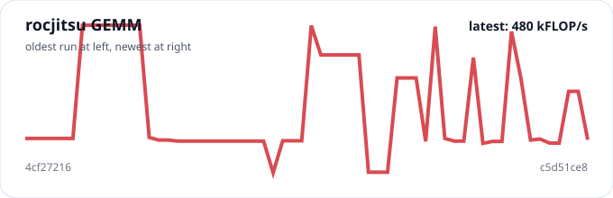
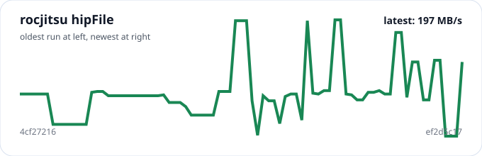
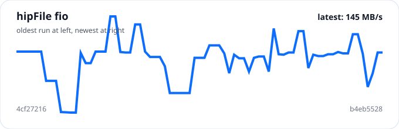

This page is generated during the Pages publish from retained benchmark history on
`gh-pages`, using the latest rocjitsu and hipFile fio report artifacts as inputs.
It mirrors the same basic model used by the ROCm/rocm-ernic site: badges for the
latest published numbers, a durable history file, and a trend page regenerated as
new CI data lands.

## Latest published snapshot

Generated from `ef2d5c17` at **2026-10-20 19:18 UTC**.

Badge colour is health, not branding. Each latest reading is compared against
the mean of the previous 5 *distinct* readings — consecutive
republishes of an unchanged number are collapsed first, because a publish is
triggered by any report lane finishing and re-records the other lanes' last
artifacts untouched. Green is at or above 95% of that
baseline, amber down to 80%, red below it, and blue
means there is not yet a second distinct reading to compare against. The band
is wide on purpose: these benchmarks run against an emulated GPU over
vfio-user and swing hard between runs.

| Metric | Latest value | Baseline (last 5 distinct) | Verdict |
| --- | --- | --- | --- |
| rocjitsu GEMM | 488 kFLOP/s | 529 kFLOP/s | watch (-8%) |
| rocjitsu hipFile | 197 MB/s | 162 MB/s | within tolerance (+21%) |
| hipFile fio | 148 MB/s | 115 MB/s | within tolerance (+29%) |

## Trend charts

### rocjitsu GEMM

### rocjitsu hipFile

### hipFile fio

## Recent runs

| Commit | Generated | GEMM | hipFile | hipFile fio |
| --- | --- | --- | --- | --- |
| 6ee9eb75 | 2026-10-17 12:17 UTC | 499 kFLOP/s | 197 MB/s | 67.5 MB/s |
| 6ee9eb75 | 2026-10-18 12:43 UTC | 509 kFLOP/s | 197 MB/s | 98 MB/s |
| 6ee9eb75 | 2026-10-19 15:59 UTC | 385 kFLOP/s | 152 MB/s | 145 MB/s |
| b4eb5528 | 2026-10-19 23:18 UTC | 385 kFLOP/s | 152 MB/s | 145 MB/s |
| b4eb5528 | 2026-10-20 13:34 UTC | 504 kFLOP/s | 199 MB/s | 176 MB/s |
| 48f9eef9 | 2026-10-20 15:59 UTC | 504 kFLOP/s | 199 MB/s | 176 MB/s |
| 48f9eef9 | 2026-10-20 16:34 UTC | 750 kFLOP/s | 109 MB/s | 88.5 MB/s |
| 2f489fa1 | 2026-10-20 18:53 UTC | 750 kFLOP/s | 109 MB/s | 88.5 MB/s |
| ef2d5c17 | 2026-10-20 18:58 UTC | 750 kFLOP/s | 109 MB/s | 88.5 MB/s |
| ef2d5c17 | 2026-10-20 19:18 UTC | 488 kFLOP/s | 197 MB/s | 148 MB/s |

## Current report freshness

A report counts as green when it carries a `pass` status stamp *and* was
generated within 36 hours of the publish. Both are needed: a
lane that fails uploads no artifact at all, so its previous report stays on the
branch and would otherwise keep reading `pass` indefinitely. The badge above
shows the last date on which all 5 reports were green at once —
amber once that date is no longer today.

Last all-green: **2026-10-20** &middot; checked
2026-10-20 19:18 UTC &middot; currently
all green.

| Report | Generated | Status | Commit | Page |
| --- | --- | --- | --- | --- |
| Single VM | 2026-10-20 18:53 UTC | pass | `2f489fa` | [/1vm/](/1vm/) |
| rocjitsu | 2026-10-20 19:15 UTC | pass | `2f489fa` | [/rocjitsu/](/rocjitsu/) |
| ernic VM 1 | 2026-10-20 18:57 UTC | pass | `2f489fa` | [/ernic/](/ernic/) |
| ernic VM 2 | 2026-10-20 18:57 UTC | pass | `2f489fa` | [/ernic/vm2/](/ernic/vm2/) |
| hipFile fio | 2026-10-20 19:17 UTC | pass | `2f489fa` | [/hipfile-fio/](/hipfile-fio/) |
