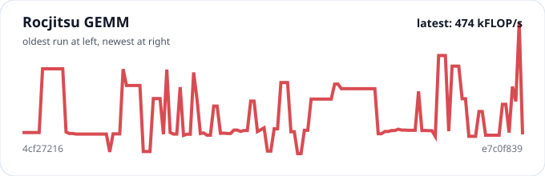
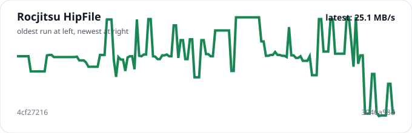
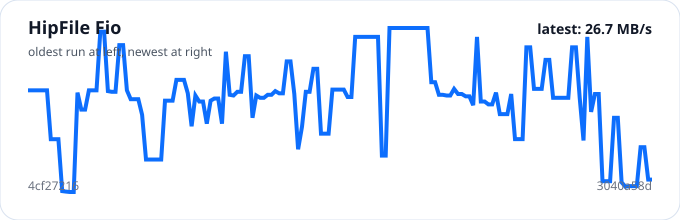

This page is generated during the Pages publish from retained benchmark history on
`gh-pages`, using the latest rocjitsu and hipFile fio report artifacts as inputs.
It mirrors the same basic model used by the ROCm/rocm-ernic site: badges for the
latest published numbers, a durable history file, and a trend page regenerated as
new CI data lands.

## Latest published snapshot

Generated from `e7c0f839` at **2026-11-02 18:04 UTC**.

Badge colour is health, not branding. Each latest reading is compared against
the mean of the previous 5 *distinct* readings — consecutive
republishes of an unchanged number are collapsed first, because a publish is
triggered by any report lane finishing and re-records the other lanes' last
artifacts untouched. Green is at or above 95% of that
baseline, amber down to 80%, red below it, and blue
means there is not yet a second distinct reading to compare against. The band
is wide on purpose: these benchmarks run against an emulated GPU over
vfio-user and swing hard between runs.

| Metric | Latest value | Baseline (last 5 distinct) | Verdict |
| --- | --- | --- | --- |
| Rocjitsu GEMM | 474 kFLOP/s | 713 kFLOP/s | regressed (-34%) |
| Rocjitsu HipFile | 161 MB/s | 194 MB/s | watch (-17%) |
| HipFile Fio | 142 MB/s | 152 MB/s | watch (-6%) |
| Ernic P4 FP8 BW | n/a | - | no data |

## Trend charts

### Rocjitsu GEMM

### Rocjitsu HipFile

### HipFile Fio

## Recent runs

| Commit | Generated | GEMM | hipFile | hipFile fio |
| --- | --- | --- | --- | --- |
| 333246f4 | 2026-10-29 18:27 UTC | 470 kFLOP/s | 165 MB/s | 137 MB/s |
| 15a9b834 | 2026-10-29 19:49 UTC | 470 kFLOP/s | 165 MB/s | 137 MB/s |
| ae551b3b | 2026-10-29 20:53 UTC | 470 kFLOP/s | 165 MB/s | 137 MB/s |
| ae551b3b | 2026-10-29 21:18 UTC | 634 kFLOP/s | 250 MB/s | 205 MB/s |
| e7c0f839 | 2026-10-30 00:02 UTC | 634 kFLOP/s | 250 MB/s | 205 MB/s |
| e7c0f839 | 2026-10-30 00:30 UTC | 484 kFLOP/s | 195 MB/s | 137 MB/s |
| e7c0f839 | 2026-10-30 15:14 UTC | 729 kFLOP/s | 134 MB/s | 79.4 MB/s |
| e7c0f839 | 2026-10-31 14:20 UTC | 650 kFLOP/s | 252 MB/s | 219 MB/s |
| e7c0f839 | 2026-11-01 15:02 UTC | 1.07 MFLOP/s | 141 MB/s | 118 MB/s |
| e7c0f839 | 2026-11-02 18:04 UTC | 474 kFLOP/s | 161 MB/s | 142 MB/s |

## Current report freshness

A report counts as green when it carries a `pass` status stamp *and* was
generated within 36 hours of the publish. Both are needed: a
lane that fails uploads no artifact at all, so its previous report stays on the
branch and would otherwise keep reading `pass` indefinitely. The badge above
shows the last date on which all 6 reports were green at once —
amber once that date is no longer today.

Last all-green: **2026-11-02** &middot; checked
2026-11-02 18:04 UTC &middot; currently
all green.

| Report | Generated | Status | Commit | Page |
| --- | --- | --- | --- | --- |
| Single VM | 2026-11-02 18:02 UTC | pass | `e7c0f83` | [/1vm/](/1vm/) |
| rocjitsu | 2026-11-02 18:00 UTC | pass | `e7c0f83` | [/rocjitsu/](/rocjitsu/) |
| ernic VM 1 | 2026-11-01 15:01 UTC | pass | `e7c0f83` | [/ernic/](/ernic/) |
| ernic VM 2 | 2026-11-01 15:01 UTC | pass | `e7c0f83` | [/ernic/vm2/](/ernic/vm2/) |
| hipFile fio | 2026-11-02 18:03 UTC | pass | `e7c0f83` | [/hipfile-fio/](/hipfile-fio/) |
| MI355X node | 2026-11-01 18:39 UTC | pass | ``unknown`` | [/mi355x/](/mi355x/) |
